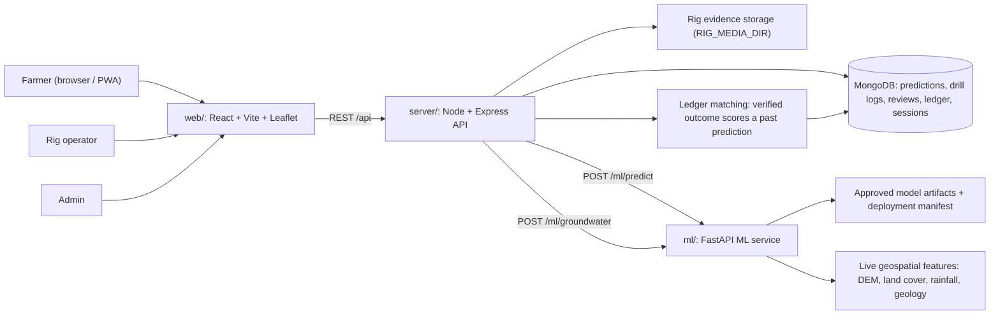

<p align="center"></p>

# BoreSakshi

Know before you drill: a borewell prediction app for farmers that publishes how accurate its own predictions turn out to be, using verified drilling outcomes from rig operators.

## Overview

In hard-rock regions of Tamil Nadu, a farmer can spend lakhs of rupees on a borewell that comes up dry, often on the word of a water diviner or a driller with no track record. Public data on dry borewells barely exists, so nobody can say how reliable any prediction is.

BoreSakshi ("bore witness") tackles both halves of that problem:

1. **Prediction.** A farmer taps a location on a map and gets either an ML estimate (chance of success, likely depth and yield, with uncertainty and explanations) or an honest "no estimate" with the verified wells nearby. It never shows a guessed number.
2. **Accountability.** Every prediction is stored. When a rig operator later logs a real drilling outcome nearby and an admin verifies it, the earlier prediction is scored predicted-vs-actual, and the results feed a public accuracy ledger.

Alongside the borewell estimate, the app gives an **India-wide groundwater outlook** (shallow water-table depth before and after the monsoon) from a model trained on public CGWB monitoring wells.

The borewell estimate is limited to a pilot area (Namakkal / Tiruchengode belt). The project started as an entry for the MSME Idea Hackathon 6.0 (credited on the landing screen) and was then extended in numbered phases (documented in [`docs/`](docs)) toward a production pilot.

## Key features

**Farmers (public, no login)**
- Leaflet map with tap-to-predict; Tamil (default) and English UI ([`web/src/strings.js`](web/src/strings.js)).
- Prediction panel showing probability, depth, yield, uncertainty, the model's explanation factors and the nearest verified wells (coordinates rounded to about 1 km for privacy).
- "No estimate" state with a reason when the pin is outside the pilot area, the ML service is down, or feature coverage is too low.
- Groundwater outlook anywhere in India: pre/post-monsoon water-table depth with 80% ranges, chance that water is within 10 m, rock type and the nearest monitored well.
- Public ledger page (`/ledger`): predictions issued and scored, accuracy, Brier score/calibration, depth and yield error, by model version and region.
- Rule-based help bot that answers from fixed text and restates the shown numbers; it makes no AI call ([`web/src/helpBot.js`](web/src/helpBot.js)).

**Rig operators (account required)**
- Mobile-first drilling log: GPS location, date, depth, water strikes, yield, geological layers, optional VES/ERT resistivity readings, photo/video evidence, optional voice input.
- Offline logging: records and files are queued in IndexedDB and sent when the device is back online ([`web/src/offlineQueue.js`](web/src/offlineQueue.js)).
- Dashboard and history of their own logs, server-computed trust profile, re-review requests for rejected submissions.

**Admins**
- Review queue for submitted logs (`SUBMITTED -> UNDER_REVIEW -> VERIFIED / REJECTED`) with deterministic suspicious-data signals and an append-only audit trail.
- Operator management (verify, deactivate), flagged logs, all-wells map, CSV export.
- Data ingestion of external datasets with provenance, quality reports and publish gates.

**ML and operations**
- Python ML service (FastAPI) with candidate training, spatially blocked scientific evaluation, calibration, conformal uncertainty and a versioned prediction contract.
- Continuous learning with mandatory human approval: candidates are staged, compared with production and only activated with an explicit `DEPLOY` confirmation; rollback is explicit too. This is adaptive retraining, not reinforcement learning.
- Silent pilot mode (`ML_SILENT_PILOT=YES`): estimates are stored and scored but not shown to farmers.
- Revocable server-side sessions with httpOnly cookies, recovery codes, rate limits, security event audit, encrypted backups, Prometheus metrics, Docker Compose deployment with monitoring.

## Architecture



| Component | Role |
|---|---|
| [`web/`](web) | React 18 SPA (PWA with service worker). Screens for the farmer map, ledger, operator dashboard/log/history and admin console. All API calls go through [`web/src/api.js`](web/src/api.js). |
| [`server/`](server) | Express API (ES modules). Validates every write with zod, owns auth/sessions, stores predictions and drill logs, runs the verification workflow and ledger matching, and calls the ML service through a client with timeouts, retries and a circuit breaker ([`mlClient.js`](server/mlClient.js)). |
| [`ml/`](ml) | Python package `boresakshi_ml` (training, evaluation, inference, serving) plus [`ml/public_data/`](ml/public_data) scripts that build public-data features and train the groundwater model. Served by [`ml/service.py`](ml/service.py). |
| MongoDB | Single data store, accessed only through [`server/db.js`](server/db.js). |
| [`deploy/`](deploy) | Production and staging Docker Compose files, Caddy reverse proxy example, Prometheus/Alertmanager/Loki/Grafana config, backup and restore scripts, systemd timers. |
| [`api/index.js`](api/index.js) + [`vercel.json`](vercel.json) | Optional Vercel demo deployment (web + API, without the ML service). |

## How it works

**Prediction request**
1. The farmer taps a point; the web app calls `POST /api/predict`.
2. The server checks the pilot bounding box ([`pilotRegion.js`](server/pilotRegion.js)). Inside it, it calls `POST /ml/predict` on the ML service.
3. The ML service extracts live geospatial features for that point, loads the model chain named by the human-approved active deployment pointer, and returns probability, depth and yield with calibration, conformal ranges, explanations and coverage metadata.
4. The server validates the response against the versioned prediction contract ([`predictionContract.js`](server/predictionContract.js)). If anything fails (outside pilot area, model not ready, low coverage, bad contract), it returns `estimateAvailable: false` with a reason.
5. Valid estimates are stored with model version, feature version and an immutable feature snapshot reference; repeat taps in the same cell and period share one record.
6. In parallel, the server requests the groundwater outlook (`POST /ml/groundwater`); it is displayed but never stored in the ledger.

**Accountability loop**
1. An operator submits a drill log (`POST /api/borewells`); it starts as `SUBMITTED` and is untrusted.
2. An admin reviews the evidence and marks it `VERIFIED` or `REJECTED`.
3. On verification, [`ledgerMatching.js`](server/ledgerMatching.js) scores one earlier prediction: the one linked by id, otherwise the nearest within the match radius (250 m by default) made before drilling.
4. `GET /api/ledger` and the `/ledger` page publish the resulting accuracy, calibration and error metrics for the trained model only. If an outcome is later reopened, it is removed from current metrics and kept in history.

## Results

From [`docs/ml-data-and-training-plan.md`](docs/ml-data-and-training-plan.md) (sections 8 to 10):

**Groundwater outlook model** (LightGBM, trained on 19,602 CGWB open-well monitoring stations across India, readings since 2015). Mean absolute error with whole 0.5 degree regions held out:

| Area | Before monsoon | After monsoon |
|---|---|---|
| All India | 3.51 m (nearby-wells baseline 3.76 m) | 3.08 m (baseline 3.35 m) |
| Tamil Nadu | 2.48 m | 2.49 m |
| North India | 4.47 m | 4.14 m |

The 80% ranges covered 80.0% (pre-monsoon) and 79.7% (post-monsoon) of held-out stations.

**Borewell model status.** The documented helper models trained on public well data did not pass the project's own release gates (regional hold-out R² near zero), so none was saved. A borewell success model needs rig records that include dry holes, which is why the operator logging and verification workflow exists. Until reviewed artifacts are configured, the ML service reports not-ready and the app shows "no estimate".

## Tech stack

| Layer | Technologies |
|---|---|
| Frontend | React 18, Vite 6, React Router 7, Leaflet / React Leaflet, lucide-react, react-hot-toast, service worker + IndexedDB |
| Backend | Node.js, Express, MongoDB driver, zod, bcrypt, JWT, cookie sessions, morgan, Node test runner |
| ML | Python 3.12, FastAPI, Uvicorn, scikit-learn, XGBoost, LightGBM, pandas, NumPy; rasterio, pyproj, geopandas, SciPy for geospatial features |
| Data sources | CGWB well and water-level data, Copernicus DEM, ESA WorldCover, CHIRPS rainfall, SoilGrids, MODIS, GSI geology |
| Ops | Docker, Docker Compose, Caddy, Prometheus, Alertmanager, Loki, Fluent Bit, Grafana, restic backups, systemd timers, GitHub Actions |

## Project structure

```text
BoreSakshi/
├── web/                     # React farmer / operator / admin UI
│   └── src/
│       ├── screens/         # Landing, map, ledger, operator dashboard/log/history, admin/*
│       ├── components/      # MapView, PredictionPanel, HelpBot, AppHeader, ...
│       ├── api.js           # Single HTTP client
│       ├── strings.js       # Tamil and English strings
│       └── offlineQueue.js  # Offline drill-log queue
├── server/                  # Express API
│   ├── index.js             # App setup, auth, admin and ingestion routes
│   ├── predict.js           # Prediction orchestration and no-estimate logic
│   ├── phase8Routes.js      # Rig operator data collection and evidence
│   ├── phase9Routes.js      # Verification lifecycle and review
│   ├── phase11Routes.js     # Prediction storage and public ledger
│   ├── phase15Routes.js     # Sessions, recovery, security endpoints
│   ├── ledgerMatching.js    # Scores predictions against verified outcomes
│   ├── groundwater.js       # Groundwater outlook client and validation
│   ├── migrations/          # Versioned MongoDB migrations
│   ├── scripts/             # Backup, restore, dataset build, preflight
│   └── test/                # Node test suites (unit, API, real-Mongo e2e)
├── ml/
│   ├── boresakshi_ml/       # Training, evaluation, inference, serving package
│   ├── public_data/         # Public-data feature extraction and groundwater model training
│   ├── service.py           # FastAPI service (/ml/predict, /ml/groundwater, /ml/health)
│   ├── train.py, evaluate.py, continuous.py, activate.py
│   └── tests/               # pytest suites
├── deploy/                  # Compose topologies, monitoring, backup scripts, runbooks
├── docs/                    # Phase design docs, completion reports, ML data plan
└── .github/workflows/       # CI and per-phase pipelines
```

## Getting started

### Prerequisites

- Node.js and npm
- MongoDB running locally (default `mongodb://localhost:27017/`, database `BoreSakshi`)
- Python 3.12 (only for the ML service)

### 1. Backend

```bash
cd server
npm install
cp .env.example .env      # then fill in the values
node seed.js              # optional: sample drill logs around 11.36, 77.80
npm start                 # http://localhost:4000  (npm run dev for watch mode)
```

To make an existing operator account an admin, run `node makeAdmin.js <phone_number>` from `server/` ([`makeAdmin.js`](server/makeAdmin.js)).

### 2. Web

```bash
cd web
npm install
npm run dev               # http://localhost:5173
```

The web app reads `VITE_API_URL` (default `http://localhost:4000`). Map tiles need internet access.

### 3. ML service (optional)

Without it, the app runs and returns "no estimate" for borewells.

```bash
cd ml
python -m venv .venv
# activate the virtual environment
python -m pip install -r requirements-candidates.txt
# for the groundwater outlook also:
python -m pip install -r requirements.txt -r requirements-data.txt
python -m uvicorn service:app --host 127.0.0.1 --port 8000
```

The borewell model only serves once reviewed artifacts, the feature manifest and `BORESAKSHI_PHASE6_APPROVED=YES` are configured. The groundwater model needs the git-ignored `ml/data_public` folder (trained model and map layers).

### Environment variables

Server ([`server/.env.example`](server/.env.example)):

| Variables | Purpose |
|---|---|
| `MONGODB_URI`, `MONGODB_DB`, `PORT`, `FRONTEND_URL` | Database, port, allowed web origin |
| `JWT_SECRET`, `RIG_EVIDENCE_SECRET`, `SESSION_TTL_HOURS`, `BCRYPT_ROUNDS` | Auth, sessions and evidence signing |
| `API_RATE_LIMIT`, `AUTH_RATE_LIMIT`, `SIGNIN_FAILURE_LIMIT`, `PASSWORD_RESET_LIMIT`, `PREDICT_RATE_LIMIT`, `ADMIN_RATE_LIMIT` | Rate limits |
| `ML_SERVICE_URL`, `ML_SERVICE_TIMEOUT_MS`, `ML_SERVICE_RETRIES`, `ML_CIRCUIT_FAILURE_THRESHOLD`, `ML_CIRCUIT_COOLDOWN_MS`, `REQUIRE_ML_READY`, `ML_SILENT_PILOT` | ML service connection and release mode |
| `PILOT_BBOX`, `LEDGER_MATCH_RADIUS_KM`, `LEDGER_MATCH_WINDOW_DAYS` | Pilot area and ledger matching |
| `RIG_MEDIA_DIR`, `RIG_MEDIA_UPLOAD_LIMIT`, `RIG_MEDIA_DURABLE`, `RIG_EVIDENCE_UNBOUND_MAX_AGE_HOURS` | Evidence uploads |
| `BACKUP_ENCRYPTION_KEY_BASE64`, `BACKUP_DIR`, `MONITORING_TOKEN`, `INGESTION_MAX_BYTES` | Backups, metrics and ingestion |
| `DEPLOYMENT_ENV`, `RELEASE_VERSION`, `GRACEFUL_SHUTDOWN_MS`, `OFFSITE_BACKUP_CONFIGURED`, `CENTRAL_LOGGING_CONFIGURED`, `ALERT_DELIVERY_CONFIGURED` | Production preflight attestations |

Groundwater settings: `GROUNDWATER_OUTLOOK=NO` disables it, `ML_GROUNDWATER_TIMEOUT_MS` sets its timeout.

ML service ([`ml/.env.example`](ml/.env.example)): `BORESAKSHI_DEPLOYMENT_MANIFEST`, `BORESAKSHI_PHASE4_RUN_DIR`, `BORESAKSHI_PHASE5_EVALUATION_DIR`, `BORESAKSHI_FEATURE_MANIFEST`, `BORESAKSHI_PHASE6_APPROVED` (global serving switch), `BORESAKSHI_MIN_FEATURE_COVERAGE_PCT`, `BORESAKSHI_WARN_FEATURE_COVERAGE_PCT`, `LOG_LEVEL`, `ML_WORKERS`, plus `BORESAKSHI_PUBLIC_DATA_DIR` / `BORESAKSHI_GROUNDWATER` for the groundwater model.

### Tests

```bash
cd server && npm run test:all          # full Node suite (real-Mongo e2e needs PHASE17_E2E=YES: npm run test:phase17:e2e)
cd web && npm test                     # UI logic tests
cd ml && python -m pytest              # ML regression, leakage and inference tests
```

### Model lifecycle commands

```bash
cd ml
python continuous.py stage ...          # register a candidate
python continuous.py approve ...        # human approval artifact
python continuous.py stage-deployment ...
python continuous.py activate ... --confirm DEPLOY
python continuous.py rollback ... --confirm ROLLBACK
```

Production deployment (Compose, migrations, backups, monitoring) is described in [`deploy/README.md`](deploy/README.md) and [`docs/phase-18-production-deployment.md`](docs/phase-18-production-deployment.md).

## API overview

| Endpoint | Description |
|---|---|
| `POST /api/predict` | Borewell estimate (pilot area) or no-estimate, plus nearby verified wells and the groundwater outlook |
| `GET /api/ledger`, `/api/ledger/entries`, `/api/ledger/models`, `/api/ledger/regions` | Public accountability metrics |
| `POST /api/auth/signup`, `POST /api/auth/signin`, `POST /api/auth/signout` | Operator accounts (signup returns a one-time recovery code) |
| `POST /api/borewells`, `GET /api/borewells/mine` | Submit and list the operator's drill logs |
| `GET /api/admin/operators`, `GET /api/admin/logs`, `PATCH /api/admin/operators/:id`, `PATCH /api/admin/logs/:id` | Admin console |
| `/api/admin/ingestion/*` | External dataset ingestion, review and publish |
| `GET /api/health` | Liveness and database status |
| ML: `POST /ml/predict`, `POST /ml/groundwater`, `GET /ml/health`, `GET /ml/model-info` | Internal ML service |

## Limitations and roadmap

- **No production borewell model yet.** Public data lacks dry-hole records; training a real model is blocked on rig-operator partnerships, a hydrogeologist-defined success criterion and access to some government layers (see section 8 of the [ML plan](docs/ml-data-and-training-plan.md)).
- The borewell estimate is limited to the Namakkal / Tiruchengode pilot box.
- The groundwater outlook describes the shallow open-well water table, not whether a borewell will strike water, and needs internet access for live map layers.
- Operator trust scores are review aids, not model probabilities.
- Site assignments for operators are not created by the app yet.
- The Vercel deployment is demo-only: no ML service, no evidence uploads.
- A real production cutover needs real infrastructure, secrets, durable storage and reviewed ML artifacts, as listed in [`deploy/PILOT-RUNBOOK.md`](deploy/PILOT-RUNBOOK.md).

Phase-by-phase design notes and completion reports (phases 2 to 11, 15, 17 and 18) are in [`docs/`](docs).

## Author

Built by [Suriyaprakash](https://github.com/suriyaprakash-25).
